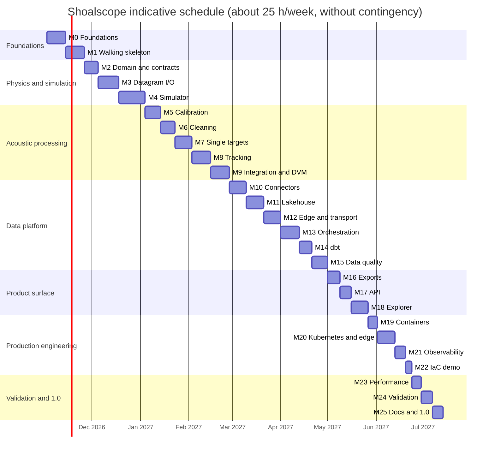
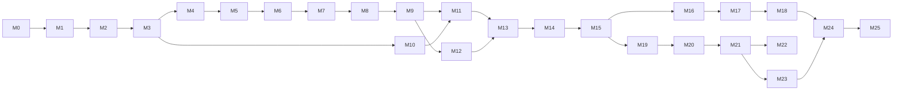

# Roadmap

> **Status (2026-11-02):** planning is complete: research, architecture and the first fourteen
> ADRs are in [`docs/`](docs/). No product code exists yet. The next item is **M0.8**.

Shoalscope is built in eight phases and 26 milestones. A thin end-to-end slice comes first
(M1), and every later milestone deepens one stage of that slice, so the project works from
early on and gets better with each step.

## How to read this roadmap

- **IDs** are `M<milestone>.<item>`. Each open item has one GitHub issue, created and closed by
  `scripts/sync_roadmap_issues.py`; this file stays the source of truth.
- **Estimates** are hours of focused work, including tests and documentation for that item.
- **`[x]`** marks items merged to `main`. Exit criteria must hold before a milestone closes.
- Items marked *stretch* are optional within their milestone.
- Background for every decision: [domain research](docs/research/01-fisheries-acoustics.md),
  [data sources](docs/research/02-data-sources.md),
  [technology landscape](docs/research/03-technology-landscape.md),
  [architecture](docs/architecture.md) and [ADRs](docs/adr/README.md).

## Summary

| Phase | Milestone | Hours | Release |
| :-- | :-- | --: | :-- |
| 0. Foundations | [M0 Engineering foundations](#m0--engineering-foundations) | 41 | |
| 1. Walking skeleton | [M1 Thin end-to-end slice](#m1--walking-skeleton-thin-end-to-end-slice) | 43 | v0.1.0 |
| 2. Physics, formats and simulation | [M2 Domain model, units and contracts](#m2--domain-model-units-and-contracts) | 32 | |
| | [M3 Simrad datagram I/O and byte-range reading](#m3--simrad-datagram-io-and-byte-range-reading) | 46 | |
| | [M4 Physics-based echosounder simulator](#m4--physics-based-echosounder-simulator) | 59 | v0.2.0 |
| 3. Acoustic processing | [M5 Calibration and environment](#m5--calibration-and-environment) | 36 | |
| | [M6 Echogram cleaning (L2B)](#m6--echogram-cleaning-l2b) | 33 | |
| | [M7 Single-target detection and in-situ TS](#m7--single-target-detection-and-in-situ-target-strength) | 39 | |
| | [M8 Fish tracking and counting](#m8--fish-tracking-and-counting) | 42 | |
| | [M9 Echo integration, categories, schools and migration](#m9--echo-integration-categories-schools-and-vertical-distribution) | 42 | v0.3.0 |
| 4. Data platform | [M10 Source connectors and small-data ingestion](#m10--source-connectors-and-small-data-ingestion) | 41 | |
| | [M11 Lakehouse: Icechunk arrays and Iceberg tables](#m11--lakehouse-icechunk-arrays-and-iceberg-tables) | 41 | |
| | [M12 Edge node and streaming transport](#m12--edge-node-and-streaming-transport) | 40 | |
| | [M13 Orchestration and scheduling](#m13--orchestration-and-scheduling-with-dagster) | 42 | |
| | [M14 Transformations and analytics](#m14--transformations-and-analytics-with-dbt) | 30 | |
| | [M15 Data quality, contracts and data observability](#m15--data-quality-contracts-and-data-observability) | 36 | v0.4.0 |
| 5. Standards and product surface | [M16 Interoperable exports and metadata](#m16--interoperable-exports-and-metadata) | 30 | |
| | [M17 Read API and OGC services](#m17--read-api-and-ogc-services) | 26 | |
| | [M18 Echogram explorer](#m18--echogram-explorer-web-app) | 41 | v0.5.0 |
| 6. Production engineering | [M19 Containers and supply chain](#m19--containers-and-supply-chain) | 23 | |
| | [M20 Kubernetes, GitOps and edge deployment](#m20--kubernetes-gitops-and-edge-deployment) | 39 | |
| | [M21 Observability and SRE](#m21--observability-and-sre) | 26 | |
| | [M22 Infrastructure as code (optional cloud demo)](#m22--infrastructure-as-code-optional-cloud-demo) | 16 | v0.6.0 |
| 7. Validation, performance and 1.0 | [M23 Performance and scale](#m23--performance-and-scale) | 23 | |
| | [M24 Scientific validation and reproducibility](#m24--scientific-validation-and-reproducibility) | 24 | |
| | [M25 Documentation, write-up and 1.0](#m25--documentation-write-up-and-10) | 25 | v1.0.0 |
| | **Total** | **916** | |

**Done:** 29 h (M0.1–M0.7, M0.9). **Open:** 887 h. With 15 % contingency, that is about 1,030 hours:
roughly nine to ten months at 25 hours a week.

### Indicative schedule

### Critical path

M10 (connectors) can start in parallel with the acoustic milestones once M3 is done, and M19
(containers) can start as soon as the services exist.

## Principles

1. **Physics and rules, never learned models.** Every output is explained by an equation or a
   cited rule ([ADR-0002](docs/adr/0002-deterministic-rule-based-processing.md)).
2. **Small data by design.** Read byte ranges, sample on a duty cycle, enforce budgets, keep
   only derived levels ([ADR-0004](docs/adr/0004-small-data-by-design.md)).
3. **Truth before accuracy claims.** Every algorithm is scored against the simulator's ground
   truth before it touches real data ([ADR-0012](docs/adr/0012-simulator-as-ground-truth.md)).
4. **Traceable numbers.** Every product records its sources, calibration, environment,
   configuration and code ([ADR-0007](docs/adr/0007-tables-in-iceberg.md)).
5. **Contracts first.** Schemas and contracts change before the code that uses them
   ([ADR-0011](docs/adr/0011-schemas-and-data-contracts.md)).
6. **Community standards.** Echolevels, SONAR-netCDF4, AcMeta, ICES formats, MacLennan symbols.
7. **Privacy and attribution by construction.** Allowlists for metadata, generated citations
   ([ADR-0013](docs/adr/0013-privacy-allowlist-and-attribution.md)).
8. **Everything as code.** Infrastructure, dashboards, alerts, policies and repository settings.
9. **Honest science.** Assumptions, uncertainty and limitations sit next to every result.

## Definition of done (every item)

- [ ] Merged by pull request with CI green; Conventional Commit messages.
- [ ] Tests at the right level (unit, property, integration, end-to-end); coverage does not drop.
- [ ] `ruff`, `mypy --strict` and `lint-imports` pass.
- [ ] Docs updated: reference for interfaces, a how-to for anything a user runs.
- [ ] Schemas and contracts updated first; breaking changes versioned.
- [ ] No secrets, no personal data, data budgets respected, sources attributed.
- [ ] An ADR is added or superseded when a recorded decision changes.
- [ ] This file is ticked and README.md is updated if the change affects it.

---

## Phase 0: Foundations

### M0 · Engineering foundations

**Goal:** a repository where every later change is linted, typed, tested, documented and
released automatically.

- [x] **M0.1** (2 h) Repository bootstrap: MIT licence, `.gitignore`, `.editorconfig`,
  `.gitattributes`, `.env.example`, pre-commit with gitleaks, codespell, markdownlint and
  Conventional Commits.
- [x] **M0.2** (10 h) Planning: fisheries-acoustics research, data sources verified against
  the live services, technology landscape, fourteen ADRs, architecture and this roadmap.
- [x] **M0.3** (3 h) Repository settings as code (`scripts/repo-settings.sh`): merge commits
  only, a ruleset that forbids force-pushes and deleting `main`, secret scanning with push
  protection, private vulnerability reporting and topics.
- [x] **M0.4** (3 h) Roadmap-to-issues sync (`scripts/sync_roadmap_issues.py`): milestones,
  labels and one issue per open item, idempotent, closes issues for ticked items.
- [x] **M0.5** (4 h) uv workspace with the nine packages from
  [ADR-0014](docs/adr/0014-python-toolchain-monorepo.md); Python 3.13 pin and `uv.lock`; Ruff,
  mypy (strict), pytest with Hypothesis and branch coverage failing under 85 %; import-linter
  contracts for the dependency rules.
- [x] **M0.6** (2 h) `justfile` (`setup`, `fmt`, `lint`, `typecheck`, `test`, `docs`, `up`,
  `down`, `e2e`, `budget`) and a devcontainer with the same tool versions.
- [x] **M0.7** (3 h) Dependency policy: `tools/check_dependencies.py` fails on licences outside
  the allowlist and on any ML library, model runtime or model API client; runs in pre-commit and
  CI. Renovate: grouped, scheduled, custom managers for pinned tool versions.
- [ ] **M0.8** (5 h) GitHub Actions CI: lint, type check, hooks and tests (matrix by suite), uv
  cache, concurrency groups, read-only default permissions, actions pinned by commit SHA,
  coverage in the job summary and one aggregate `CI passed` check; a `require-ci` ruleset in
  `scripts/repo-settings.sh`.
- [x] **M0.9** (2 h) Extend pre-commit with Ruff, mypy, import-linter, uv-lock, actionlint,
  ShellCheck, hadolint, yamllint, check-jsonschema and Buf.
- [ ] **M0.10** (3 h) Documentation site with Zensical in the Diátaxis structure (tutorials,
  how-to guides, reference, explanation), research and ADR pages, deployed to GitHub Pages by a
  workflow.
- [ ] **M0.11** (2 h) Community files: CONTRIBUTING, CODE_OF_CONDUCT, SECURITY (private
  vulnerability reporting), issue forms (bug, feature, spike), pull request template and
  CODEOWNERS.
- [ ] **M0.12** (2 h) Releases: release-please with Conventional Commits, CHANGELOG, and
  `CITATION.cff` validated in pre-commit.

**Exit criteria:** a pull request that breaks formatting, lint, types, tests, licences or the
ML deny-list cannot merge; documentation publishes on merge; a release pull request opens
automatically.

## Phase 1: Walking skeleton

### M1 · Walking skeleton: thin end-to-end slice

**Goal:** every stage exists in its simplest form and runs end to end on a laptop with one
command, from synthetic raw bytes to a number in an API and a chart.

- [ ] **M1.1** (4 h) Minimal simulator: one channel, a few point targets and Gaussian noise,
  written as an EK80-style CW raw file that echopype opens; ground truth as Parquet.
- [ ] **M1.2** (4 h) Minimal L0 → L2A: open the file with echopype, compute Sv with the file's
  calibration values, write the window to an Icechunk repository on local disk.
- [ ] **M1.3** (4 h) Minimal L3/L4: MVBS on a fixed grid and NASC per time cell with
  `echopype.commongrid`; NASC rows appended to an Iceberg table with PyIceberg.
- [ ] **M1.4** (5 h) Local platform in Docker Compose: SeaweedFS, PostgreSQL, Lakekeeper with
  a bootstrapped warehouse, Dagster webserver and daemon; health checks; `just up`.
- [ ] **M1.5** (5 h) Dagster code location with three assets (`l2a_sv_window`, `l3_mvbs`,
  `l4_nasc_cells`), a static partition per synthetic window and one blocking asset check.
- [ ] **M1.6** (5 h) Spike: dbt-duckdb on the Lakekeeper catalog with DuckDB 2.0; which
  materialisations work against an attached Iceberg catalog; result and fallback recorded in
  [ADR-0007](docs/adr/0007-tables-in-iceberg.md).
- [ ] **M1.7** (3 h) One dbt model (`mart_nasc_hourly`) with tests and a model contract.
- [ ] **M1.8** (4 h) FastAPI service with `/health` and `/v1/nasc`, reading the mart through
  DuckDB; OpenAPI document published with the docs.
- [ ] **M1.9** (3 h) `shoalscope demo` CLI command that renders an echogram PNG and an hourly
  NASC chart, used in the README.
- [ ] **M1.10** (4 h) End-to-end test in CI: Compose up, run the job, call the API, and compare
  NASC with the value the simulator inserted, within a stated tolerance.
- [ ] **M1.11** (2 h) Release v0.1.0 with notes and a demo walkthrough in the docs.

**Exit criteria:** `just up && just e2e` passes on a fresh clone in under 15 minutes; v0.1.0 is
tagged.

## Phase 2: Physics, formats and simulation

### M2 · Domain model, units and contracts

**Goal:** one vocabulary for pings, channels, calibrations, targets, tracks and cells, with
physics that is tested against published numbers.

- [ ] **M2.1** (4 h) Domain types: platform, deployment, transducer, channel, ping window,
  calibration set, environment profile, target, track, cell and school; immutable dataclasses
  with validation; typed IDs.
- [ ] **M2.2** (3 h) Echolevels vocabulary (L0–L4) and the processing-attribute schema every
  dataset and table carries: level, software version, calibration set, environment profile and
  configuration hash ([ADR-0003](docs/adr/0003-echolevels-as-storage-layers.md)).
- [ ] **M2.3** (4 h) Units: unit-suffixed names (`range_m`, `sv_db`, `sv_linear_per_m`) and
  typed decibel and linear wrappers, so means can only be taken in the linear domain; Hypothesis
  round-trip tests.
- [ ] **M2.4** (4 h) Acoustics library: wavelength, near-field range, range resolution, TVG,
  sa ↔ NASC ↔ sv conversions, density from NASC and σbs, equivalent beam angle; each function
  checked against worked examples from Simmonds & MacLennan (2005).
- [ ] **M2.5** (4 h) Sound speed (TEOS-10 via gsw; Mackenzie 1981) and absorption
  (Francois–Garrison 1982), vectorised over depth profiles and tested against published check
  values.
- [ ] **M2.6** (3 h) Reference tables as versioned, cited YAML with JSON Schemas: TS–length
  relationships (source, frequency, species group, caveats; Pacific hake b20 = −68 dB from
  Traynor 1996 with the Henderson & Horne 2007 caveat), dB-difference rule windows and sphere
  material properties.
- [ ] **M2.7** (4 h) Contracts first: ODCS v3 contracts for the first L4 tables
  (`nasc_cells`, `single_targets`, `tracks`); Protobuf schemas for edge messages with Buf lint
  and breaking-change checks.
- [ ] **M2.8** (3 h) Typed processing configurations (Pydantic) with JSON Schema export,
  configuration hashing for provenance, and versioned presets (`ooi-ce04osps`,
  `noaa-hake-ek80`, `sim-default`).
- [ ] **M2.9** (3 h) Solar position (Meeus 1998) and day, night and twilight classification,
  tested against published almanac values.

**Exit criteria:** physics functions match published check values within stated tolerances;
contracts, schemas and reference tables validate in CI.

### M3 · Simrad datagram I/O and byte-range reading

**Goal:** read exactly the bytes that matter from multi-hundred-megabyte raw files, locally or
over HTTPS and S3, and write valid files for the simulator.

- [ ] **M3.1** (5 h) Streaming datagram reader for EK60 and EK80 `.raw`: length-prefix framing,
  trailing length check, Windows FILETIME timestamps, typed records for `CON0`, `XML0`, `FIL1`,
  `NME0`, `MRU0`, `RAW0`, `RAW3` and `RAW4`; unknown types skipped and counted.
- [ ] **M3.2** (3 h) Index reader for `IDX0` datagrams (ping time, ping number, position, byte
  offset) and a reader for `.bot` seabed datagrams.
- [ ] **M3.3** (6 h) Window planner and byte-range reader: from a time window, compute byte
  ranges from the index plus the configuration header, fetch them with obstore over HTTPS or
  S3 with retries, and re-frame complete datagrams; never read beyond the plan.
- [ ] **M3.4** (4 h) Window assembly into a self-contained mini `.raw` (configuration plus the
  selected pings) that echopype converts unchanged; equality tests against echopype on the full
  file for the same pings.
- [ ] **M3.5** (4 h) Incremental tail reader for a growing file: resumes at the last complete
  datagram and tolerates partial writes and file rotation.
- [ ] **M3.6** (3 h) Metadata extraction with an allowlist: transducers, frequencies, pulse
  settings, environment and software version from `XML0`; everything else dropped and counted
  ([ADR-0013](docs/adr/0013-privacy-allowlist-and-attribution.md)).
- [ ] **M3.7** (6 h) Datagram writer for EK80-style CW files (configuration, environment,
  parameters, `RAW3` power and angle samples, `MRU0`, `NME0`) for the simulator; round-trip
  property tests between reader and writer.
- [ ] **M3.8** (4 h) Robustness: generated and mutated byte streams (truncated, corrupted
  lengths, garbage) never crash the reader or allocate unbounded memory; a fuzz job in CI
  (*stretch*: coverage-guided fuzzing with Atheris).
- [ ] **M3.9** (3 h) Conformance suite against echopype's public test files (fetched with pooch
  in CI, never committed): same pings, timestamps and sample counts.
- [ ] **M3.10** (3 h) Benchmarks of parse throughput and peak memory; a 60-second OOI-sized
  window parses in under one second on a laptop.
- [ ] **M3.11** (5 h) Index-less windows: interpolation search on datagram timestamps, where
  each probe reads 256 KiB and resynchronises on the first datagram whose length, type and
  trailing length agree; derived time-to-offset points cached as a sparse index; tested on the
  NOAA hake EK80 files, which have no `.idx`.

**Exit criteria:** a 60-second window of a live OOI file is read over HTTPS with less than
2.5 MB transferred, and echopype converts it to the same values as a local full-file read; a
15-second window of an index-less NOAA file is found and read with under 10 MB transferred.

### M4 · Physics-based echosounder simulator

**Goal:** realistic synthetic echosounder data with exact ground truth, to test every later
algorithm ([ADR-0012](docs/adr/0012-simulator-as-ground-truth.md)).

- [ ] **M4.1** (4 h) Scenario format (YAML with a JSON Schema, seeded): platform, transducers,
  channels, environment profile, duration, ping rate, scatterer populations and noise sources.
- [ ] **M4.2** (5 h) Transducer model: circular-piston beam pattern per channel from the
  beamwidth, split-beam angles with SNR-dependent phase noise, and an equivalent beam angle
  consistent with the pattern.
- [ ] **M4.3** (6 h) Propagation and sonar equation: spreading, profile-based absorption and
  sound speed, TVG, received power per sample from σbs, pulse shape and range resolution.
- [ ] **M4.4** (6 h) Fish: length distributions, TS from the M2.6 TS–length tables,
  tilt-dependent TS, Rayleigh-distributed echo amplitudes, 3D positions and velocities.
- [ ] **M4.5** (5 h) Behaviour: random-walk and directed swimming, schools as clustered point
  processes, diel vertical migration driven by solar elevation (M2.9), optional avoidance of the
  platform.
- [ ] **M4.6** (5 h) Background scattering: zooplankton layers with a frequency response, the
  seabed with roughness and its dead zone, surface bubbles.
- [ ] **M4.7** (5 h) Noise and artefacts: background noise, impulse noise, transient bursts,
  attenuated pings and false bottoms, each with rate and strength parameters.
- [ ] **M4.8** (4 h) Platform motion: heave, pitch and roll written as `MRU0`; ship transects
  with GPS `NME0` sentences; fixed moorings.
- [ ] **M4.9** (4 h) Writers: EK80-style raw files through M3.7, `.idx` index files, and ground
  truth (targets per ping, tracks, cell densities, artefact masks) as Parquet with a schema.
- [ ] **M4.10** (4 h) Scenario library: `mooring-dvm` (OOI-like, 38/120/200 kHz),
  `survey-transect` (hake-survey-like), `river-passage` (side-looking, fish crossing a line),
  `calibration-sphere`, `stress-dense-schools` and `stress-noisy`.
- [ ] **M4.11** (6 h) Closure tests: integrating simulated scatterers returns the inserted area
  density within tolerance; the sphere's TS is recovered on axis; noise-free single targets are
  recovered exactly; the same seed gives byte-identical files.
- [ ] **M4.12** (3 h) Realism note: compare simulated and real Sv statistics (noise floor, Sv
  distribution, seabed level) for OOI and NOAA windows, and document the known gaps.
- [ ] **M4.13** (2 h) Release v0.2.0: simulator and raw I/O usable as libraries, with a
  tutorial.

**Exit criteria:** every scenario opens in echopype; closure tests pass in CI; simulation gaps
are documented.

## Phase 3: Acoustic processing

### M5 · Calibration and environment

**Goal:** every calibrated number knows which calibration and which water it was computed with.

- [ ] **M5.1** (4 h) Calibration registry: versioned calibration sets per channel and validity
  interval (gain, Sa correction, beamwidths, angle offsets and sensitivities), loaded from
  raw-file values, EK80 calibration XML or manual entry; stored in Iceberg with SCD2 history.
- [ ] **M5.2** (3 h) Calibration resolution: select the valid set for any window by time and
  channel, fail closed when none applies, and record the choice in the dataset attributes.
- [ ] **M5.3** (6 h) Sphere target strength from elastic scattering theory (Faran 1951;
  MacLennan 1981) for any material, diameter, frequency and water properties, averaged over
  the pulse bandwidth; validated against −42.4 dB for a 38.1 mm tungsten-carbide sphere at
  38 kHz and against published tables.
- [ ] **M5.4** (6 h) Sphere-calibration workflow: on-axis echoes from NOAA `EK80_calibration`
  windows and the `calibration-sphere` scenario; gain and Sa-correction estimates with
  confidence intervals, a beam-pattern fit, a comparison with the instrument's stored values
  and a calibration report.
- [ ] **M5.5** (4 h) Environment profiles from the OOI CTDs: sound speed and absorption per
  depth, QARTOD flags respected, nearest-profile and interpolation rules, and a flagged
  climatology fallback.
- [ ] **M5.6** (6 h) Profile-based Sv and TS: recompute range, TVG and absorption with
  depth-varying sound speed and absorption, and quantify the difference from a single-value
  environment for each channel.
- [ ] **M5.7** (4 h) Uncertainty budget: propagate calibration, absorption and sound-speed
  uncertainty into Sv and NASC (analytic and Monte Carlo), reported per product.
- [ ] **M5.8** (3 h) Upstream contribution: open an echopype discussion offering the
  profile-based environment and sphere TS code under its licence (*stretch*: the pull request).

**Exit criteria:** sphere TS within 0.1 dB of published values; the calibration registry
drives every L2 product, and missing calibrations quarantine windows instead of defaulting.

### M6 · Echogram cleaning (L2B)

**Goal:** remove what is not fish or plankton, and record exactly what was removed and why.

- [ ] **M6.1** (4 h) Mask model: boolean masks with reason codes, source algorithm and
  configuration hash; mask algebra (union, intersection, dilation) stored alongside the cube.
- [ ] **M6.2** (4 h) Background-noise estimation and removal (De Robertis & Higginbottom 2007)
  through echopype, with per-sample SNR stored and a configurable SNR threshold.
- [ ] **M6.3** (4 h) Impulse, transient and attenuated-signal masks (Ryan et al. 2015) through
  echopype, with typed configurations per deployment preset.
- [ ] **M6.4** (4 h) Seabed detection with `echopype.mask.detect_seafloor`, a backstep and a
  dead-zone height estimate (Ona & Mitson 1996), and false-bottom detection.
- [ ] **M6.5** (3 h) Compare the detected seabed with the instrument's own `.bot` line on NOAA
  EK60 windows (for example cruise HB0706) and with the simulator's truth; report bias and
  outliers.
- [ ] **M6.6** (3 h) Range exclusions for the near field, the surface bubble layer and
  transducer ring-down, computed from transducer geometry rather than hard-coded.
- [ ] **M6.7** (3 h) Ping-level quality flags (attenuated, noisy, motion out of limits) carried
  into every downstream product.
- [ ] **M6.8** (5 h) Scoring against simulated truth: precision and recall per artefact type
  across noise levels, written to the validation results.
- [ ] **M6.9** (3 h) Performance: masks computed per window with Dask-friendly chunking; the
  memory bound per window documented.

**Exit criteria:** on `stress-noisy`, impulse noise and seabed are masked with recall of at
least 0.95; masks are reproducible bit for bit.

### M7 · Single-target detection and in-situ target strength

**Goal:** detect individual fish echoes reliably and turn them into honest TS and size-class
distributions.

- [ ] **M7.1** (6 h) Peak finding and pulse-length criteria per ping: candidates above a TS
  threshold, echo length measured at the pulse-length determination level, and a normalised
  pulse-length window.
- [ ] **M7.2** (4 h) Beam compensation from the split-beam angles and beam model; maximum
  compensation and angle-stability criteria (Soule et al. 1997).
- [ ] **M7.3** (3 h) Target positions in transducer and geographic coordinates, with motion
  compensation from `MRU0` heave, pitch and roll.
- [ ] **M7.4** (4 h) Parameter sets as versioned presets per channel, with documented defaults
  and sources; every target records its parameter-set ID.
- [ ] **M7.5** (5 h) Multiple-target diagnostics: Nv (Sawada et al. 1993) and the M index
  (Gauthier & Rose 2001) per cell; cells over threshold are flagged and excluded from in-situ TS.
- [ ] **M7.6** (4 h) TS distributions per depth layer and time cell (averaged in the linear
  domain), and TS-to-length conversion with the M2.6 tables, reported with the table ID and
  its caveat.
- [ ] **M7.7** (5 h) Validation on simulated scenarios across SNR and density: detection
  precision and recall, TS bias and angle error; a parameter-sensitivity sweep.
- [ ] **M7.8** (4 h) Real-data check on OOI and NOAA windows: TS histograms compared with
  published ranges for the expected species groups, documented with their limits.
- [ ] **M7.9** (4 h) Numba implementation of the hot loop, with property tests proving it
  matches the reference implementation.

**Exit criteria:** on `mooring-dvm`, detection recall is at least 0.9 at SNR ≥ 10 dB with a TS
bias under 0.5 dB.

### M8 · Fish tracking and counting

**Goal:** follow individual fish through the beam, to count them, size them better and see how
they move.

- [ ] **M8.1** (5 h) Motion models: a constant-velocity Kalman filter in 3D with process noise
  per deployment preset, and an alpha–beta filter as a lightweight edge option.
- [ ] **M8.2** (5 h) Gating and data association: χ² gating on the Mahalanobis distance, optimal
  assignment with `linear_sum_assignment`, and missed-detection handling.
- [ ] **M8.3** (4 h) Track management: M-of-N confirmation, maximum gap in pings, minimum track
  length and deletion, with a reason code for every ended track.
- [ ] **M8.4** (4 h) Track attributes: track-averaged TS (linear domain), length estimate, 3D
  speed and heading, vertical velocity, time in beam, and start and end positions.
- [ ] **M8.5** (3 h) Tracking from a moving ship with motion-compensated positions, alongside
  the fixed-platform mode.
- [ ] **M8.6** (5 h) Metrics against simulated truth: CLEAR-MOT (MOTA, MOTP), HOTA, identity
  switches and fragmentation; a benchmark table per scenario in CI.
- [ ] **M8.7** (4 h) Offline Rauch–Tung–Striebel smoothing for archive processing; the edge uses
  online filtering only.
- [ ] **M8.8** (5 h) Fish-passage counting on `river-passage`: a virtual counting line,
  upstream and downstream counts, a size-class split, and uncertainty from missed and
  fragmented tracks.
- [ ] **M8.9** (4 h) Echo-counting density from tracks and the sampled volume, valid only when
  Nv is low.
- [ ] **M8.10** (3 h) Explainability: each track carries the gate, filter and rule parameters
  that formed it, and a per-track diagnostic plot is available on request.

**Exit criteria:** HOTA of at least 0.7 on `river-passage` and `mooring-dvm` at nominal noise;
passage counts within ±5 % of the truth.

### M9 · Echo integration, categories, schools and vertical distribution

**Goal:** turn cleaned echograms into fish densities and behaviour metrics, with their
assumptions attached.

- [ ] **M9.1** (4 h) Cells: time cells for fixed platforms, 1 nmi EDSUs for ships, depth layers
  referenced to the surface or the seabed; cell IDs stable across reprocessing.
- [ ] **M9.2** (4 h) NASC per cell and channel through echopype, with sample counts, masked
  fractions and an SNR summary per cell.
- [ ] **M9.3** (5 h) Acoustic categories from a versioned rule table (relative frequency
  response and dB-difference windows; Korneliussen & Ona 2003); each labelled cell stores its
  rule ID, and cells no rule matches stay unclassified.
- [ ] **M9.4** (4 h) Fish density per cell from NASC and σbs (in-situ TS when the Nv gate
  passes, otherwise a TS–length table and a stated length distribution), compared with echo
  counting where both are valid.
- [ ] **M9.5** (5 h) Schools: detection with `echopype.mask.detect_shoal` per deployment preset,
  plus the descriptors of Reid (2000): morphometric, energetic, positional and multi-frequency.
- [ ] **M9.6** (4 h) Vertical distribution per profile: centre of mass, inertia, proportion
  occupied, aggregation index and equivalent area (Urmy et al. 2012).
- [ ] **M9.7** (4 h) Diel vertical migration: dusk-ascent and dawn-descent times and rates
  relative to solar elevation, as daily summary rows.
- [ ] **M9.8** (4 h) Uncertainty: bootstrap confidence intervals for densities and migration
  metrics, plus propagation of the M5.7 calibration budget.
- [ ] **M9.9** (6 h) *stretch* Broadband EK80 FM data: pulse compression, TS(f) for single
  targets and Sv(f) per cell, used as an extra input to the rule table.
- [ ] **M9.10** (2 h) Release v0.3.0: the complete processing chain as a library and a CLI
  (`shoalscope process`).

**Exit criteria:** the closure test (inserted vs integrated density) holds within ±10 % on
`survey-transect`; migration timing is within 10 minutes of the simulator's truth.

## Phase 4: Data platform

### M10 · Source connectors and small-data ingestion

**Goal:** fetch only what is needed from public sources, politely, idempotently and within
budget ([ADR-0004](docs/adr/0004-small-data-by-design.md)).

- [ ] **M10.1** (4 h) Source registry: one typed record per source (URLs, terms, citation
  template, budgets, rate limit, schedule) that drives connectors, docs and attribution.
- [ ] **M10.2** (5 h) NOAA archive connector: anonymous listing by ship, cruise and instrument;
  window selection by time; index-guided or timestamp-searched byte ranges (M3.3, M3.11);
  calibration-folder discovery; ETag-based idempotency.
- [ ] **M10.3** (4 h) NOAA level-2 Zarr reader: find the chunks that overlap a processed window
  through the STAC catalogue and read only those, as an independent reference.
- [ ] **M10.4** (5 h) OOI raw-archive connector: folder crawling with conditional requests,
  new-file detection, duty-cycled index-guided windows, and safe handling of files still being
  written.
- [ ] **M10.5** (4 h) OOI ERDDAP CTD with dlt: incremental cursor on time, QARTOD flags kept,
  Parquet landing on SeaweedFS with schema-contract enforcement, then committed to Iceberg with
  PyIceberg.
- [ ] **M10.6** (3 h) Metadata ingestion with the privacy allowlist: NOAA cruise JSON reduced to
  non-personal fields; a test proves names, e-mail addresses and phone numbers never reach
  storage, logs or traces.
- [ ] **M10.7** (4 h) Data budget guard: fetch and storage budgets per source, run and day;
  planned bytes checked before fetching; fail closed with a clear error; usage written to an
  ops table.
- [ ] **M10.8** (3 h) Politeness and resilience: per-host rate limits, retries with
  exponential backoff and jitter, timeouts, a descriptive User-Agent and a circuit breaker.
- [ ] **M10.9** (3 h) Duty-cycle sampler: deterministic window schedules (for example 60 s
  every 30 min), configurable per source and profile; backfills use the same schedule.
- [ ] **M10.10** (4 h) Connector tests against a local fake server with synthetic files
  (range requests, ETags, errors, slow responses); no real data in the repository.
- [ ] **M10.11** (2 h) ETOPO 2022 bounding-box reader with a cache, for seabed QC.

**Exit criteria:** a day of OOI windows ingests with under 120 MB fetched and nothing stored
beyond L3 and L4; the budget guard blocks an oversized backfill.

### M11 · Lakehouse: Icechunk arrays and Iceberg tables

**Goal:** transactional, versioned storage for echograms and tables, with every product
traceable ([ADR-0006](docs/adr/0006-arrays-in-icechunk.md),
[ADR-0007](docs/adr/0007-tables-in-iceberg.md)).

- [ ] **M11.1** (4 h) Storage layout: one bucket, prefixes per level, Icechunk repositories per
  deployment and level, and Iceberg namespaces `l1`, `l2`, `l3`, `l4`, `ref` and `ops`.
- [ ] **M11.2** (5 h) Iceberg tables generated from the ODCS contracts (Arrow schemas, partition
  specs by day, deployment and channel, sort orders, table properties), created idempotently
  through Lakekeeper.
- [ ] **M11.3** (5 h) Iceberg writer: idempotent overwrite-by-partition and append with
  PyIceberg, commit retries on conflict, and run ID and code version in snapshot summaries.
- [ ] **M11.4** (5 h) Icechunk writer for L2B and L3 cubes: chunk shape chosen by benchmark for
  appends along time and for echogram tile reads; an ADR records the choice.
- [ ] **M11.5** (4 h) Branches and tags: reprocessing campaigns (for example a new calibration
  set) run on Icechunk and Iceberg branches, are compared, then merged or discarded; releases
  are tags.
- [ ] **M11.6** (5 h) Snapshot manifest: one row per published product linking its Iceberg
  snapshot IDs, Icechunk snapshot IDs, calibration set, environment profile, configuration
  hash, code version, source byte ranges and citations.
- [ ] **M11.7** (4 h) Maintenance: snapshot expiry, small-file compaction by partition rewrite,
  orphan-file cleanup and Icechunk garbage collection, scheduled and budget-aware.
- [ ] **M11.8** (3 h) Retention per level and profile (for example L2B 14 days, L3 90 days, L4
  indefinitely), enforced together with the storage budget.
- [ ] **M11.9** (3 h) STAC catalogue of products with pystac: collections per deployment and
  level, items per day, assets pointing at Icechunk snapshots and exports.
- [ ] **M11.10** (3 h) Reproducibility tests: rebuild a published product from its manifest and
  assert a bit-identical result; time-travel queries tested.

**Exit criteria:** any L4 number traces back to its arrays, calibration, configuration, code
and source bytes; branch and time-travel workflows are tested.

### M12 · Edge node and streaming transport

**Goal:** process pings next to the instrument and deliver compact products over an
unreliable, budgeted link ([ADR-0008](docs/adr/0008-edge-transport-nats.md)).

- [ ] **M12.1** (4 h) Edge service skeleton: asyncio service with configuration, health and
  readiness endpoints, graceful shutdown and structured logs.
- [ ] **M12.2** (5 h) Inputs: tail a growing raw file (M3.5), or replay OOI windows and
  simulator files at real or accelerated speed, through the same code path.
- [ ] **M12.3** (5 h) Streaming processing: per-ping L2A to L4 with bounded memory (rolling
  windows for noise estimation and tracking), producing targets, tracks, NASC cells and health
  summaries.
- [ ] **M12.4** (4 h) NATS leaf node with a local JetStream stream: store-and-forward with
  bounded disk, subjects `shoalscope.{deployment}.{kind}.v{n}`, message IDs for deduplication.
- [ ] **M12.5** (5 h) Telemetry budget manager: byte budget per hour, priority classes (health
  and alarms, NASC cells, tracks, targets, echogram thumbnails), adaptive decimation, and a
  backlog policy for long outages.
- [ ] **M12.6** (3 h) Compact encodings: Protobuf messages with delta-encoded times and
  quantised values; payload-size tests against the budget.
- [ ] **M12.7** (4 h) Platform consumer: durable pull consumer that validates contracts,
  micro-batches into Iceberg (time- or size-triggered commits) and acknowledges only after the
  commit.
- [ ] **M12.8** (4 h) Link-failure tests with Toxiproxy and Testcontainers (outages, latency,
  bandwidth caps): no loss and no duplicates in Iceberg after recovery.
- [ ] **M12.9** (3 h) Edge–batch parity: the same window processed on the edge and in batch
  gives identical L4 rows.
- [ ] **M12.10** (3 h) Latency and throughput metrics from ping time to queryable row.

**Exit criteria:** a simulated 24-hour link outage recovers with no loss and within budget;
edge and batch results match.

### M13 · Orchestration and scheduling with Dagster

**Goal:** every dataset is a software-defined asset with partitions, schedules, sensors and
checks ([ADR-0009](docs/adr/0009-orchestration-dagster.md)).

- [ ] **M13.1** (4 h) Code location and resources: object store, Lakekeeper, Icechunk, NATS and
  source clients as configurable resources; environments selected by variables.
- [ ] **M13.2** (5 h) Asset graph by level: L1 to L4 assets per deployment, reference assets
  (calibration, environment, ETOPO) and ops assets (budget usage, manifests).
- [ ] **M13.3** (5 h) Partitions: dynamic partitions per OOI window and NOAA file, daily
  partitions for CTD and summaries, multi-partitions (deployment × day).
- [ ] **M13.4** (4 h) Sensors: new OOI files, new CTD rows, edge batches landed in Iceberg, and
  new calibration sets (which start a reprocessing branch).
- [ ] **M13.5** (3 h) Schedules: hourly discovery, nightly summaries and migration metrics,
  weekly maintenance (M11.7) and a monthly validation run.
- [ ] **M13.6** (4 h) Declarative automation conditions for downstream assets and freshness
  policies on L4 assets.
- [ ] **M13.7** (3 h) Backfills that respect budgets: concurrency pools per source, run-queue
  limits and a budget pre-check.
- [ ] **M13.8** (4 h) Partition-aware, idempotent I/O managers for Iceberg (PyIceberg) and
  Icechunk.
- [ ] **M13.9** (3 h) dagster-dbt and dagster-dlt integration, so dbt models and dlt sources
  appear as assets with lineage.
- [ ] **M13.10** (3 h) Failure handling: retry policies, run-failure sensors with alerts and
  per-op timeouts.
- [ ] **M13.11** (4 h) Tests: unit tests per asset with in-memory resources, partition-key
  tests and a full-graph test on the simulator in CI.

**Exit criteria:** the platform runs unattended for seven days on the OOI feed within budget,
with every check green or alerting.

### M14 · Transformations and analytics with dbt

**Goal:** analysis-ready marts on fish density, behaviour and data health, tested like code
([ADR-0010](docs/adr/0010-transformations-dbt.md)).

- [ ] **M14.1** (3 h) dbt project on DuckDB over the Iceberg catalog, using the M1.6 pattern;
  sources defined from the contracts; SQLFluff with the dbt templater.
- [ ] **M14.2** (4 h) Staging and intermediate models for NASC cells, targets, tracks, schools,
  CTD, calibrations and budget usage.
- [ ] **M14.3** (4 h) Marts: daily fish density per depth layer and category, migration metrics
  per day, track summaries (counts, TS, speed) and a school catalogue.
- [ ] **M14.4** (3 h) Survey mart: NASC per 1 nmi EDSU along NOAA transects, ready for the ICES
  export (M16.4).
- [ ] **M14.5** (3 h) Ops marts: data-budget usage, freshness and QC outcomes per source and
  day.
- [ ] **M14.6** (3 h) dbt snapshots (SCD2) for calibration sets and deployment metadata.
- [ ] **M14.7** (4 h) Incremental models with partition-aware strategies, and tests that
  incremental runs equal full refreshes.
- [ ] **M14.8** (4 h) Tests: dbt unit tests for every non-trivial model, generic and singular
  data tests, and model contracts on all marts.
- [ ] **M14.9** (2 h) dbt docs and exposures (API, web app) published with the documentation.

**Exit criteria:** every mart is contracted, tested and documented; incremental runs equal full
refreshes.

### M15 · Data quality, contracts and data observability

**Goal:** bad data is caught, quarantined and explained, never silently published
([ADR-0011](docs/adr/0011-schemas-and-data-contracts.md)).

- [ ] **M15.1** (4 h) ODCS v3 contracts for every Iceberg table, with quality rules and service
  levels; `datacontract test` in CI and at runtime.
- [ ] **M15.2** (3 h) Pandera schemas generated from the contracts, validating Polars frames
  before every write.
- [ ] **M15.3** (5 h) Acoustic QC suite as Dagster asset checks: monotonic, unique ping times;
  expected ping rate; noise-floor drift; SNR per channel; impulse-noise and attenuated-ping
  fractions; Nv/M exceedance; calibration age.
- [ ] **M15.4** (3 h) Seabed consistency: detected seabed against ETOPO 2022 along tracks and at
  the OOI site, within tolerance bands.
- [ ] **M15.5** (3 h) CTD QC with ioos_qc (QARTOD gross range, spike, flat line, rate of change)
  in addition to OOI's own flags.
- [ ] **M15.6** (3 h) Volume and freshness anomaly checks with robust z-scores per source and
  day.
- [ ] **M15.7** (4 h) Quarantine: failing windows go to quarantine tables with reasons, and a
  replay command re-runs them after a fix.
- [ ] **M15.8** (3 h) Data-quality scorecard mart and dashboard per deployment and level.
- [ ] **M15.9** (3 h) IOOS compliance-checker (CF, ACDD) on every netCDF export, in CI and in
  production.
- [ ] **M15.10** (3 h) Runbooks for every blocking check: what it means, likely causes, how to
  investigate and how to release.
- [ ] **M15.11** (2 h) Release v0.4.0: the data platform end to end.

**Exit criteria:** faults injected through `stress-noisy` and through malformed source responses
are caught by named checks and land in quarantine with a reason.

## Phase 5: Standards and product surface

### M16 · Interoperable exports and metadata

**Goal:** products that other fisheries-acoustics software can read, carrying their provenance
and citations.

- [ ] **M16.1** (5 h) SONAR-netCDF4 v2.0 export of L3 cubes from Icechunk, including the
  Gridded group.
- [ ] **M16.2** (3 h) CF-1.x and ACDD attributes on every netCDF and Zarr export.
- [ ] **M16.3** (4 h) ICES AcMeta metadata for every L3 and L4 product, validated against its
  schema.
- [ ] **M16.4** (5 h) ICES acoustic-format export (Cruise, Log, Sample, Data, Instrument,
  Calibration, DataAcquisition and DataProcessing records) for survey NASC, validated against
  the published XSD and ICES vocabularies.
- [ ] **M16.5** (3 h) Echolevels processing attributes and the snapshot manifest embedded in
  every export.
- [ ] **M16.6** (4 h) Provenance: OpenLineage events from Dagster and dbt sent to Marquez, and a
  W3C PROV JSON summary per product.
- [ ] **M16.7** (3 h) Attribution generator: the citation each source requires (OOI's format,
  NOAA NCEI) added to every product and API response that uses it.
- [ ] **M16.8** (3 h) Round-trip tests: exports re-opened by echopype, xarray and netCDF tools;
  plain Zarr exports opened by zarrita.js.

**Exit criteria:** every export validates in CI; each product's citation and provenance are
machine-readable.

### M17 · Read API and OGC services

**Goal:** stable, documented interfaces for programs and GIS tools.

- [ ] **M17.1** (5 h) FastAPI read API v1: deployments, products, NASC cells, densities, tracks,
  schools and migration metrics; cursor pagination; filters by time, depth and category.
- [ ] **M17.2** (3 h) HTTP semantics: ETags and conditional requests, cache headers, RFC 9457
  problem details and request IDs.
- [ ] **M17.3** (4 h) OGC API – Environmental Data Retrieval with pygeoapi: position, area and
  cube queries on L3 cubes and L4 grids.
- [ ] **M17.4** (3 h) Zarr over HTTP with xpublish for echogram tiles from Icechunk snapshots.
- [ ] **M17.5** (3 h) STAC browsing of the product catalogue, served statically by the API.
- [ ] **M17.6** (3 h) Contract tests with Schemathesis against the OpenAPI document; versioning
  and deprecation policy.
- [ ] **M17.7** (3 h) Load tests with k6 and p95 latency budgets in CI on a small fixture
  dataset.
- [ ] **M17.8** (2 h) Rate limits and request-size limits; no accounts, read-only data.

**Exit criteria:** OpenAPI and EDR conformance tests pass; p95 latency stays within budget.

### M18 · Echogram explorer (web app)

**Goal:** anyone can open a browser and explore echograms, fish tracks and densities.

- [ ] **M18.1** (4 h) Web app scaffold: TypeScript (strict), Vite, Biome, Vitest and Playwright,
  with its own CI job.
- [ ] **M18.2** (8 h) WebGL2 echogram renderer reading Zarr v3 chunks with zarrita.js: zoom and
  pan over time and range, EK500-style and perceptually uniform colour maps (safe for
  colour-vision deficiency), and dB range control.
- [ ] **M18.3** (4 h) Multi-frequency views: per-channel echograms, a dB-difference view and a
  category overlay.
- [ ] **M18.4** (5 h) Overlays: noise and seabed masks, single targets, tracks coloured by TS
  and school outlines, with details on click.
- [ ] **M18.5** (4 h) Time series with DuckDB-WASM over Parquet exports: daily density per
  layer, migration metrics and passage counts.
- [ ] **M18.6** (3 h) Provenance panel: snapshot manifest, calibration set, configuration and
  citations for what is on screen.
- [ ] **M18.7** (3 h) Accessibility to WCAG 2.2 AA: keyboard navigation, focus states, contrast
  and text alternatives for charts.
- [ ] **M18.8** (4 h) Playwright end-to-end and visual-regression tests.
- [ ] **M18.9** (4 h) Static demo on GitHub Pages with simulator data and small derived
  products, under a size budget, built in CI.
- [ ] **M18.10** (2 h) Release v0.5.0.

**Exit criteria:** the public demo loads in under 3 seconds on a mid-range laptop and passes
the accessibility checks.

## Phase 6: Production engineering

### M19 · Containers and supply chain

**Goal:** small, signed, reproducible images for every service.

- [ ] **M19.1** (4 h) Multi-stage Dockerfiles per service (uv builder, slim or distroless
  runtime, non-root, read-only file system), hadolint clean.
- [ ] **M19.2** (3 h) Multi-architecture builds (amd64 and arm64) with BuildKit caching in CI.
- [ ] **M19.3** (3 h) Image-size and start-up-time budgets enforced in CI.
- [ ] **M19.4** (3 h) SBOMs with Syft, attached to images and releases.
- [ ] **M19.5** (3 h) Keyless signing with Cosign and build-provenance attestations, verified at
  deploy time.
- [ ] **M19.6** (2 h) OpenSSF Scorecard workflow and badge; dependency review on pull requests.
- [ ] **M19.7** (3 h) Compose profiles (`core`, `edge`, `observability`, `full`) with images
  pinned by digest.
- [ ] **M19.8** (2 h) Reproducible builds with pinned base digests and `SOURCE_DATE_EPOCH`,
  checked by a rebuild job.

**Exit criteria:** every image is multi-arch, signed, attested and within its size budget.

### M20 · Kubernetes, GitOps and edge deployment

**Goal:** the whole platform deploys declaratively, from a laptop cluster to an arm64 edge
board.

- [ ] **M20.1** (6 h) Helm charts for the API, edge service, consumer, pipelines and web app;
  upstream charts for Dagster, NATS, PostgreSQL, SeaweedFS and Lakekeeper pinned as
  dependencies.
- [ ] **M20.2** (3 h) chart-testing, kubeconform and Helm unit tests in CI.
- [ ] **M20.3** (3 h) Local cluster with k3d and a local registry via `just cluster`.
- [ ] **M20.4** (5 h) Argo CD app of apps with `dev` and `demo` environments, sync waves and
  health checks.
- [ ] **M20.5** (3 h) Secrets with SOPS and age; no plaintext secrets in Git or values files.
- [ ] **M20.6** (4 h) Policies with Conftest: non-root, resource requests and limits, pinned
  digests, no `latest` tags and required network policies.
- [ ] **M20.7** (3 h) Network policies and the restricted pod security standard.
- [ ] **M20.8** (5 h) Edge profile: k3s on an arm64 board (Raspberry Pi 5 class) running the
  edge service and a NATS leaf node, with bounded-disk JetStream and offline-tolerant image
  updates.
- [ ] **M20.9** (4 h) Ephemeral preview environment in CI (kind) running the end-to-end test on
  every release candidate.
- [ ] **M20.10** (3 h) Upgrade and rollback runbook, proven by a rollback drill.

**Exit criteria:** a clean k3d cluster reaches a healthy, synced state from Git alone; the edge
profile runs on arm64.

### M21 · Observability and SRE

**Goal:** the platform reports its own health, data freshness and budget use, against stated
objectives.

- [ ] **M21.1** (5 h) OpenTelemetry traces, metrics and logs from the edge service, consumer,
  Dagster runs and API, with trace context carried in NATS headers from ping to row.
- [ ] **M21.2** (3 h) Grafana LGTM stack in Compose and Kubernetes; dashboards as code.
- [ ] **M21.3** (4 h) Dashboards: pipeline health, data freshness per level, edge link and
  budget, bytes fetched per source, API.
- [ ] **M21.4** (4 h) SLOs with error budgets: L4 freshness after OOI file publication, edge
  delivery ratio, API availability and latency.
- [ ] **M21.5** (3 h) Alert rules routed by severity, each linked to a runbook.
- [ ] **M21.6** (4 h) Chaos drills (object store down, catalog down, NATS hub down, source
  errors) with documented results.
- [ ] **M21.7** (3 h) Capacity view: bytes fetched and stored per source and level against
  budgets.

**Exit criteria:** every SLO has a dashboard and an alert; each chaos drill ends with the
platform recovering on its own or a runbook that worked.

### M22 · Infrastructure as code (optional cloud demo)

**Goal:** a short-lived public demo that can be created and destroyed from code.

- [ ] **M22.1** (5 h) OpenTofu modules for a minimal cloud demo (object storage and a small
  Kubernetes cluster or VM) behind provider-neutral interfaces.
- [ ] **M22.2** (3 h) Remote state with locking; environments as workspaces.
- [ ] **M22.3** (3 h) tflint, `tofu validate` and plans in CI, with Conftest policies on plans.
- [ ] **M22.4** (3 h) Cost guardrails: budgets and automatic teardown, so the demo runs for
  hours, not days.
- [ ] **M22.5** (2 h) Release v0.6.0.

**Exit criteria:** `tofu apply` then `tofu destroy` leaves no resources behind, and the demo
works in between.

## Phase 7: Validation, performance and 1.0

### M23 · Performance and scale

**Goal:** fast enough for real-time edge processing and comfortable archive backfills.

- [ ] **M23.1** (4 h) Profiling of the processing chain on OOI-sized windows, with flame
  graphs in the docs.
- [ ] **M23.2** (4 h) Chunking and Dask tuning for archive processing, with memory ceilings
  per worker.
- [ ] **M23.3** (4 h) Edge performance budget on arm64: three channels at 1 Hz processed in real
  time with under 50 % CPU and under 1 GB RAM.
- [ ] **M23.4** (8 h) *stretch* Rust datagram parser (PyO3 and maturin) for the hot path, with
  property tests proving it matches the Python reader.
- [ ] **M23.5** (3 h) Benchmarks in CI with regression thresholds.

**Exit criteria:** the edge budget holds on arm64; benchmark regressions fail CI.

### M24 · Scientific validation and reproducibility

**Goal:** a reproducible report that states how accurate Shoalscope is, where it fails, and why.

- [ ] **M24.1** (4 h) Validation framework: scenarios × parameters × metrics, run by Dagster,
  results stored in Iceberg.
- [ ] **M24.2** (4 h) Agreement with an independent pipeline: Shoalscope Sv and MVBS against
  NOAA level-2 Zarr chunks for the same pings, with differences explained.
- [ ] **M24.3** (3 h) Seabed against `.bot` lines and ETOPO, and calibration against sphere
  theory, as summary tables.
- [ ] **M24.4** (4 h) Detection, tracking and density accuracy across the SNR and density grid,
  with failure envelopes.
- [ ] **M24.5** (4 h) Sensitivity analysis of key parameters (thresholds, TS–length table,
  absorption) on densities and migration metrics.
- [ ] **M24.6** (5 h) Validation report built with Quarto in CI and published with the docs,
  including a limitations section.

**Exit criteria:** the validation report rebuilds from a clean checkout and every number in it
traces to a manifest.

### M25 · Documentation, write-up and 1.0

**Goal:** a newcomer can run, understand and extend Shoalscope from the documentation alone.

- [ ] **M25.1** (4 h) Tutorials: run the demo in 10 minutes, process an OOI window, simulate
  and score a scenario.
- [ ] **M25.2** (4 h) How-to guides: add a source, add a deployment preset, add a rule table,
  run a reprocessing campaign, recover a quarantined window.
- [ ] **M25.3** (4 h) Reference generated from code: CLI, configuration schemas, contracts, API
  and message schemas.
- [ ] **M25.4** (4 h) Explanation: a fisheries-acoustics primer, architecture, decisions and
  the data-budget design.
- [ ] **M25.5** (3 h) Review every ADR and supersede outdated ones.
- [ ] **M25.6** (4 h) Write-up: a design article on index-guided ingestion, the two-format
  lakehouse and simulator-based verification.
- [ ] **M25.7** (2 h) Release v1.0.0.

**Exit criteria:** a reviewer outside the project completes the 10-minute tutorial unaided;
v1.0.0 is tagged with signed artefacts.

---

## Risks and mitigations

| Risk | Likelihood | Impact | Mitigation |
| :-- | :-- | :-- | :-- |
| DuckDB cannot materialise dbt models into the Iceberg catalog | Medium | Medium | Spike in M1.6; PyIceberg-written marts or DuckLake fallback ([ADR-0007](docs/adr/0007-tables-in-iceberg.md)) |
| OOI or NOAA changes paths, formats or availability | Medium | High | Source registry, connector contract tests, simulator keeps every test independent of live sources |
| echopype API changes between releases | Medium | Medium | Pinned version, Renovate, conformance suite (M3.9) |
| Index files missing or inconsistent with raw files | Medium | Medium | Framing checks on every range and timestamp search with resync (M3.3, M3.11) |
| Simulator not realistic enough | Medium | Medium | Realism note (M4.12) and real-data agreement checks (M24) |
| Python 3.13 pin held back by dagster-dbt | Low | Low | Revisit when it supports 3.14 (ADR-0014) |
| Storage or bandwidth budget exceeded | Low | Medium | Fail-closed budget guard (M10.7) and CI budget of 20 MiB |
| Personal data in source metadata | Medium | High | Allowlists and a leak test (M3.6, M10.6) |
| Scope creep | High | Medium | Stretch items are optional; milestones close on exit criteria |

## Assumptions

- About 25 hours of focused work a week; estimates include tests and docs.
- All sources stay publicly accessible without accounts.
- Development happens on one laptop with Docker; the arm64 edge profile can be tested on a
  Raspberry Pi 5 class board or under emulation.

## Progress log

| Date | Items | Hours | Notes |
| :-- | :-- | --: | :-- |
| 2026-11-02 | M0.1–M0.4 | 18 | Repository bootstrap, research, ADRs, architecture, roadmap, settings and issue sync |
| 2026-11-02 | M0.5–M0.7, M0.9 | 11 | Engineering foundations: workspace, tooling, CI, docs and release automation |
