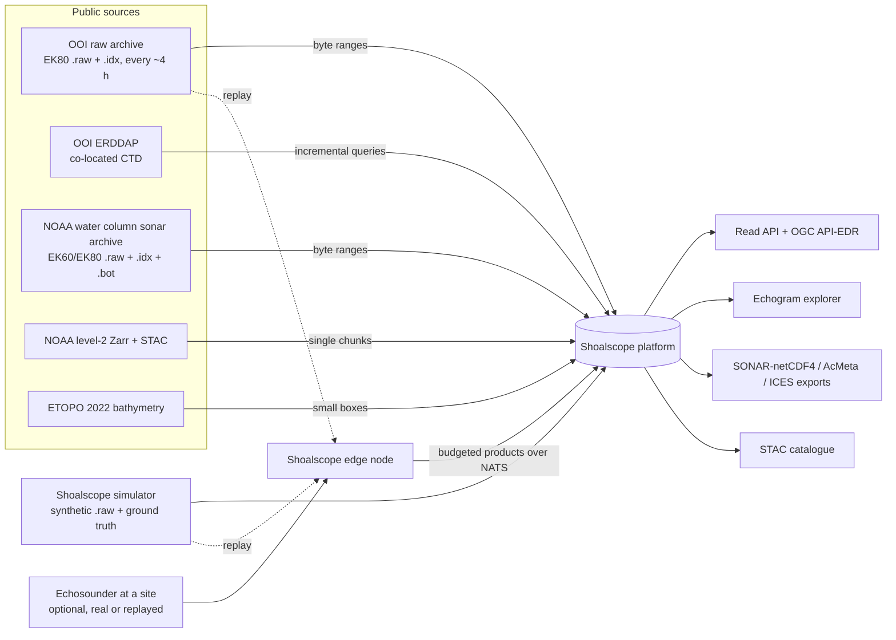
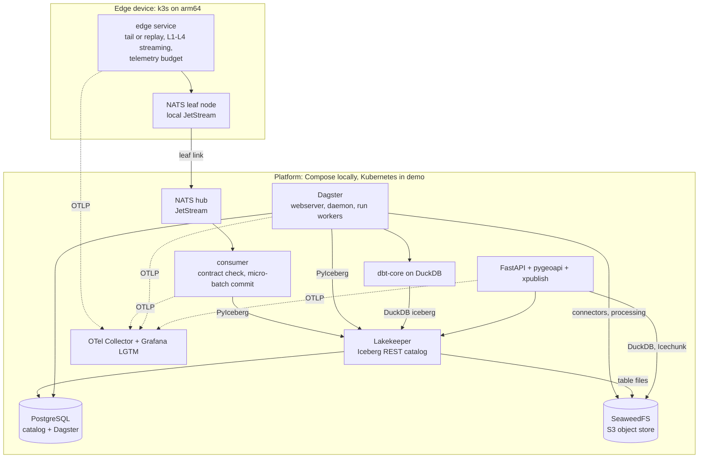
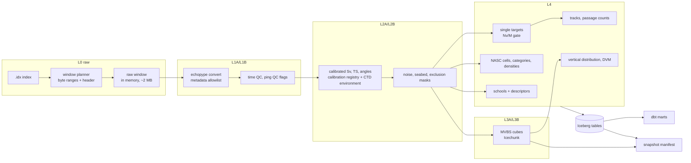
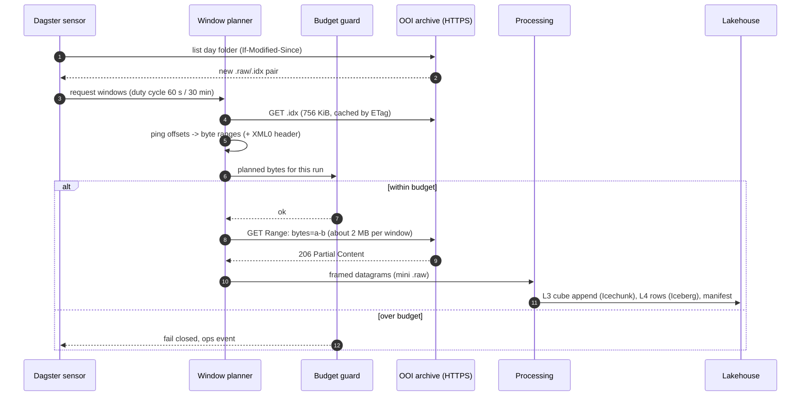
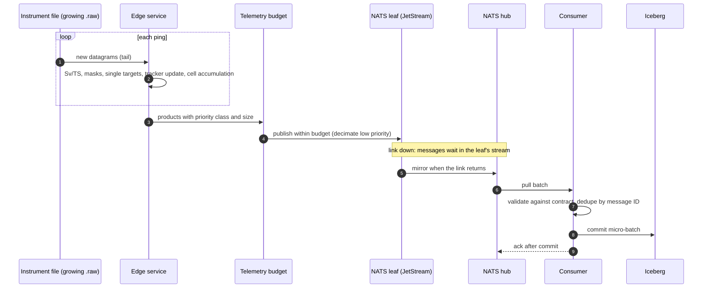
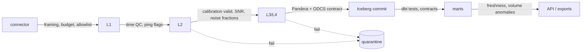

# Architecture

> Target architecture for Shoalscope 1.0. The [roadmap](../ROADMAP.md) builds it in thin
> slices; the [ADRs](adr/README.md) record why each part was chosen. Diagrams are Mermaid so
> they render on GitHub and in the documentation site.

## 1. Purpose in one paragraph

Shoalscope turns raw split-beam echosounder data into trustworthy fish-monitoring products
(single targets, fish tracks, passage counts, densities per depth layer, school catalogues and
diel-migration metrics) using only physics and published rules. It reads public observatory
and survey archives a few megabytes at a time, can run next to an instrument on a small edge
device, and stores everything in a versioned lakehouse where every number traces back to the
exact bytes, calibration and code that produced it.

## 2. System context



Users: fisheries and ocean scientists exploring observatory time series, data engineers
studying a production-grade sonar platform, and operators running an edge deployment.

## 3. Containers



| Container | Responsibility | Package |
| :-- | :-- | :-- |
| Edge service | Tail a growing raw file or replay windows; process pings to L4 with bounded memory; publish within a byte budget | `shoalscope-edge` |
| NATS leaf node / hub | Store-and-forward, deduplication, replay | — |
| Consumer | Validate messages against contracts, micro-batch into Iceberg, acknowledge after commit | `shoalscope-pipelines` |
| Dagster | Connectors, processing, maintenance, checks, schedules, sensors | `shoalscope-pipelines` |
| dbt | Marts for density, migration, tracks, surveys, data quality, budgets | `transform/` |
| Lakekeeper + PostgreSQL | Iceberg REST catalog | — |
| SeaweedFS | S3-compatible storage for Iceberg files and Icechunk repositories | — |
| API | Read API, OGC API–EDR, Zarr over HTTP, STAC, exports | `shoalscope-api` |
| Web app | Echogram explorer and charts (static build) | `web/` |
| Observability | Traces, metrics, logs, dashboards, alerts | — |

## 4. Data flow by processing level



| Level | Stored where | Retention (dev profile) | Contract |
| :-- | :-- | :-- | :-- |
| L0 | Not stored; `.idx` files cached in a size-capped LRU cache | Cache cap 64 MiB | Datagram framing checks |
| L1A/L1B | In memory only, except when a window is quarantined | 7 days in quarantine | SONAR-netCDF4 structure via echopype |
| L2A/L2B | Icechunk, only windows marked as evidence (for example quarantined or sampled for validation) | 14 days | Array schema and attributes |
| L3A/L3B | Icechunk per deployment | 90 days | Array schema and attributes |
| L4 | Iceberg tables in namespace `l4` | Indefinitely (tiny) | ODCS contracts |
| Reference | Iceberg `ref` (calibration sets, environment profiles, rule tables, source registry) | Indefinitely | ODCS contracts |
| Ops | Iceberg `ops` (budget usage, manifests, QC outcomes, quarantine) | 1 year | ODCS contracts |

## 5. Ingestion: index-guided byte ranges



The same planner serves NOAA files (S3 or HTTPS) and the edge's replay mode. When an index is
missing or inconsistent, a header scan finds ping boundaries instead.

## 6. Edge path



## 7. Storage layout

```text
s3://shoalscope/
  icechunk/
    l2/<deployment>/            Icechunk repository (evidence windows)
    l3/<deployment>/            Icechunk repository (MVBS cubes; branches for reprocessing)
  warehouse/                    Iceberg data and metadata managed by Lakekeeper
    l1/  l2/  l3/  l4/  ref/  ops/
  landing/                      dlt Parquet landing for API sources (short retention)
  exports/                      SONAR-netCDF4, AcMeta, ICES, Parquet, plain Zarr for the web
  stac/                         STAC catalogue
```

Key Iceberg tables (contracts in `contracts/`, from M2.7):

| Namespace | Table | Grain | Partitioned by |
| :-- | :-- | :-- | :-- |
| `l4` | `single_targets` | one detected echo | day, deployment, channel |
| `l4` | `tracks` | one fish track | day, deployment |
| `l4` | `nasc_cells` | channel × time or distance cell × depth layer | day, deployment |
| `l4` | `densities` | category × cell × layer | day, deployment |
| `l4` | `schools` | one detected school | day, deployment |
| `l4` | `vertical_distribution` | profile (time cell) × channel | day, deployment |
| `l4` | `passage_counts` | counting line × interval × direction | day, deployment |
| `ref` | `calibration_sets` | channel × validity interval (SCD2) | — |
| `ref` | `environment_profiles` | profile × depth | day |
| `ops` | `budget_usage`, `qc_outcomes`, `quarantine`, `product_manifests` | event | day |

## 8. Provenance: the snapshot manifest

Every published product writes one manifest row:

| Field | Example |
| :-- | :-- |
| `product_id` | `ooi-ce04osps/l4/densities/2026-10-01` |
| `iceberg_snapshots` | `{"l4.densities": 6189…, "ref.calibration_sets": 4410…}` |
| `icechunk_snapshots` | `{"l3/ooi-ce04osps": "1CECHNKREPO0SNAPSHOT"}` |
| `calibration_set_ids`, `environment_profile_ids` | per channel |
| `config_hash`, `rule_table_ids` | SHA-256 of the processing config; TS–length and category tables |
| `code_version`, `echopype_version` | release tag and dependency version |
| `sources` | URLs, byte ranges and ETags read |
| `citations` | generated attribution text |

Rebuilding a product from its manifest must reproduce it bit for bit (M11.10).

## 9. Quality gates



Blocking checks stop a partition from being published and route it to quarantine with a reason;
non-blocking checks raise warnings on the scorecard. Every blocking check has a runbook (M15.10).

## 10. Deployment views

| Environment | How | Purpose |
| :-- | :-- | :-- |
| Laptop | Docker Compose profiles `core`, `edge`, `observability`, `full` | Development and the 10-minute demo |
| CI | Compose for end-to-end tests; kind for release candidates | Every pull request and release |
| Local cluster | k3d + Argo CD (app of apps) | GitOps rehearsal |
| Edge | k3s on an arm64 board with the edge service and a NATS leaf | Next to an instrument, or replaying OOI windows |
| Cloud demo (optional) | OpenTofu, torn down after use | Public demonstration |
| Static demo | GitHub Pages | Echogram explorer on synthetic and small derived data |

## 11. Observability

OpenTelemetry instruments every service. Trace context travels in NATS headers, so one trace
follows a ping from the edge to its Iceberg row. Service-level objectives:

| SLO | Target (initial) |
| :-- | :-- |
| L4 freshness after an OOI file is published | 95 % within 2 h |
| Edge delivery ratio (products delivered / produced, within budget) | ≥ 99.5 % over 7 days |
| API availability / p95 latency | 99 % / < 300 ms on the demo dataset |
| Budget compliance | 100 % of runs within fetch and storage budgets |

## 12. Security and privacy

- No accounts: the API is read-only over public-derived data. Rate limits and request-size
  limits protect it.
- Secrets come from the environment (`.env` locally, SOPS-encrypted values in Kubernetes);
  gitleaks runs on every commit and in CI.
- Metadata allowlists keep personal data out of storage, logs and traces (ADR-0013).
- Containers run as non-root with read-only file systems, signed images, SBOMs and pinned
  digests; policies are enforced with Conftest.

## 13. Failure modes and responses

| Failure | Detection | Response |
| :-- | :-- | :-- |
| Source unreachable or slow | Connector errors, freshness SLO | Backoff and circuit breaker; partition retried by sensor |
| Index file inconsistent with raw | Framing check on the first datagram of a range | Header-scan fallback; window quarantined if still inconsistent |
| File still being written | Size or ETag changes between requests | Only process pings older than a safety margin |
| Budget exceeded | Planner pre-check | Fail closed, ops event, alert |
| Calibration missing for a period | Calibration resolution | Window quarantined; never processed with silent defaults |
| Edge link down | Leaf stream backlog metric | Store-and-forward; low-priority classes decimated by the budget |
| Catalog or object store down | Health checks, commit failures | Consumer stops acknowledging; messages wait in JetStream |
| Algorithm regression | Closure tests and validation metrics in CI | Pull request blocked |

## 14. Repository layout (target)

```text
packages/            uv workspace packages (ADR-0014)
transform/           dbt project
contracts/           ODCS data contracts
proto/               Protobuf schemas (Buf)
reference/           versioned, cited reference tables (TS-length, rules, spheres)
scenarios/           simulator scenarios
web/                 echogram explorer (TypeScript)
deploy/              compose, helm, argocd, k3d, tofu, policies
docs/                Diátaxis docs, research, ADRs, validation report
tests/               cross-package integration and end-to-end tests
scripts/, tools/     repository automation and policy checks
```
