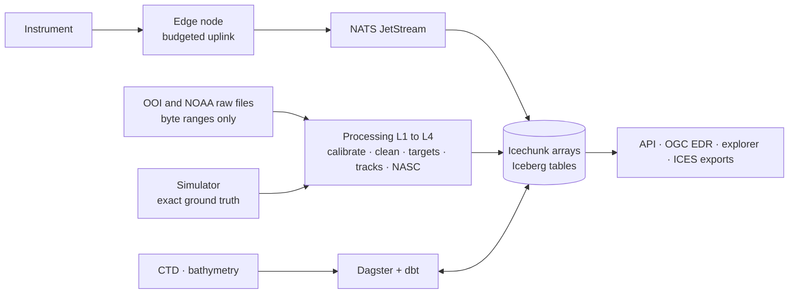

# Shoalscope

**Fish monitoring with scientific echosounders.** Shoalscope turns raw split-beam sonar data
into fish counts, tracks, sizes, densities per depth layer, school catalogues and daily
migration metrics, using only physics and published rules. It runs as a production-style data
platform: small-data ingestion from public ocean archives, an edge node for poor links, a
versioned lakehouse, orchestration, data contracts and GitOps deployment.

!!! note "Project status"

    The engineering foundations are in place (workspace, CI, dependency policy, release
    automation, these docs). The product is built milestone by milestone; see the
    [roadmap](https://github.com/soheil-mp/shoalscope/blob/main/ROADMAP.md) and the
    [open issues](https://github.com/soheil-mp/shoalscope/issues).

## How it fits together

## Where to go next

- **Tutorials**: start with [setting up a development environment](tutorials/development-setup.md)
  or [reading one ping from a 500 MB file](tutorials/read-a-remote-ping.md).
- **How-to guides**: recipes such as [adding a dependency](how-to/add-a-dependency.md).
- **Reference**: [commands](reference/commands.md) and
  [environment variables](reference/environment.md).
- **Explanation**: the [architecture](architecture.md), the
  [fisheries-acoustics research](research/01-fisheries-acoustics.md), the
  [data sources](research/02-data-sources.md) and the [decision records](adr/README.md).

## Data and attribution

Shoalscope uses synthetic data and public, non-personal environmental data. Echosounder and
CTD data: NSF Ocean Observatories Initiative. Water-column sonar archive and ETOPO 2022: NOAA
National Centers for Environmental Information. Shoalscope builds on
[echopype](https://github.com/echostack-org/echopype).
